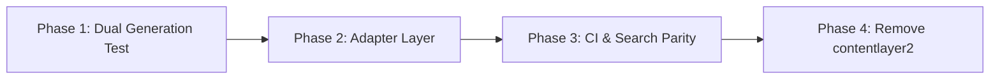

# Content Pipeline Evaluation & Migration Strategy

As identified in [Issue #1315](https://github.com/nextellarlabs/nextellar-docs/issues/1315), `nextellar-docs` currently runs Next.js with `next-contentlayer2@0.5.4`. While this community fork operates reliably for current documentation builds, upstream `contentlayer2` has not seen new releases since May 2025. This document provides an architectural assessment of future risks, evaluates modern alternatives, and outlines a zero-downtime migration path.

---

## 1. Current State & Technical Risks

The existing documentation toolchain depends on `contentlayer2` for:

- Static analysis and MDX compilation under `docs/` and `versions/`.
- Typed schema generation into `.contentlayer/generated`.
- In-memory computed fields for multi-version path parsing and localized routes.

### Primary Risks

1. **Next.js & React 19 Version Drift**: `contentlayer2` relies on monkey-patched internal webpack/turbopack hooks that may break during future Next.js major/minor updates.
2. **ESBuild & Acorn Parsing Constraints**: MDX compilation in `contentlayer2` strictly interprets bare type definitions or unescaped braces outside code fences as JSX expressions, requiring defensive markdown hygiene.
3. **Build Cache Stalling**: Changes across cross-version schemas can occasionally produce stale `.contentlayer` cache artifacts.

---

## 2. Content Pipeline Comparative Analysis

| Feature                   | `contentlayer2` (Current)   | `fumadocs` (Recommended)        | `velite`               | `@next/mdx` + `gray-matter` |
| ------------------------- | --------------------------- | ------------------------------- | ---------------------- | --------------------------- |
| **Upstream Activity**     | Inactive (May 2025)         | Highly active (Weekly releases) | Active                 | Native Next.js standard     |
| **Next.js 16+ Turbopack** | Partial compatibility       | First-class native support      | Fully supported        | Native support              |
| **Type Safety**           | Generated `.d.ts`           | Zod schema definitions          | Zod schema definitions | Manual / Type generation    |
| **Search Indexing**       | External script integration | Native built-in search provider | Extensible plugin      | Manual pipeline             |
| **Migration Friction**    | Baseline                    | Low (MDX files unmodified)      | Medium                 | High                        |

---

## 3. Recommended Architecture: Fumadocs / Velite

For modern Next.js documentation sites, **Fumadocs** or **Velite** offers the lowest friction transition:

- **Zero MDX Modification**: All 390+ markdown and MDX documents remain 100% compatible without syntax changes.
- **Strict Zod Schemas**: Replaces implicit type inference with explicit, validated runtime schemas matching `GuideFrontmatter` and `VersionedPost`.
- **Fast Build Times**: Uses modern Rust-based MDX compilers with isolated memory caching.

---

## 4. Phased Migration Roadmap



### Phase 1: Dual Generation Test

- Introduce `velite` or `fumadocs-core` in parallel with `contentlayer2`.
- Verify schema definitions in `content.config.ts` covering all guide frontmatter fields (`title`, `description`, `date`, `tags`).

### Phase 2: Adapter Layer

- Create a drop-in adapter in `src/lib/content.ts` exporting `allDocs` and `allVersionedDocs` with matching computed property interfaces.
- Update page routing imports in `src/app/` to reference the unified adapter.

### Phase 3: CI & Search Parity

- Validate `scripts/build-search-index.cjs` and `scripts/validate-search-index.cjs` against generated collections.
- Ensure all 102 unit tests pass across `routing.test.ts` and `tabs.test.tsx`.

### Phase 4: Deprecation & Cleanup

- Remove `contentlayer2` and `next-contentlayer2` from `package.json`.
- Update `npm run build` and `npm run dev` scripts.

---

## 5. Ongoing Maintenance Guidelines

Until the full pipeline migration is scheduled:

- Always run `pnpm build:content` before pushing documentation changes.
- Ensure code snippets and type annotations in MDX are wrapped in explicit triple-backtick fences (` ```typescript `) to prevent Acorn parsing failures.
